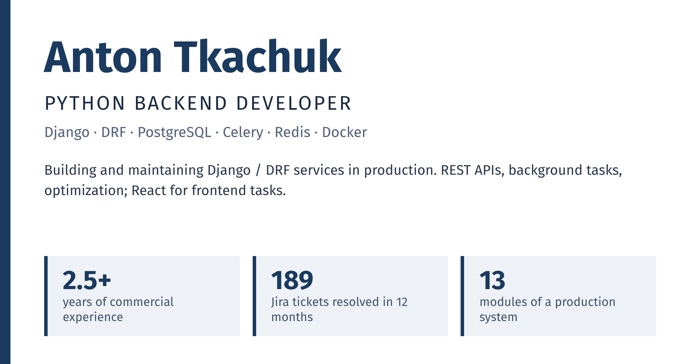

# Anton Tkachuk — Python Backend Developer

## [⬇ Download resume (PDF)](https://github.com/tkachuk2291/resume/raw/main/Anton_Tkachuk_CV.pdf)

Django · DRF · PostgreSQL · Celery · Redis · Docker

- 2.5+ years of commercial experience
- Kyiv, Ukraine · remote / office
- [LinkedIn](https://www.linkedin.com/in/anton-tkachuk2291/) · [GitHub](https://github.com/tkachuk2291) · Telegram: @ant2291
